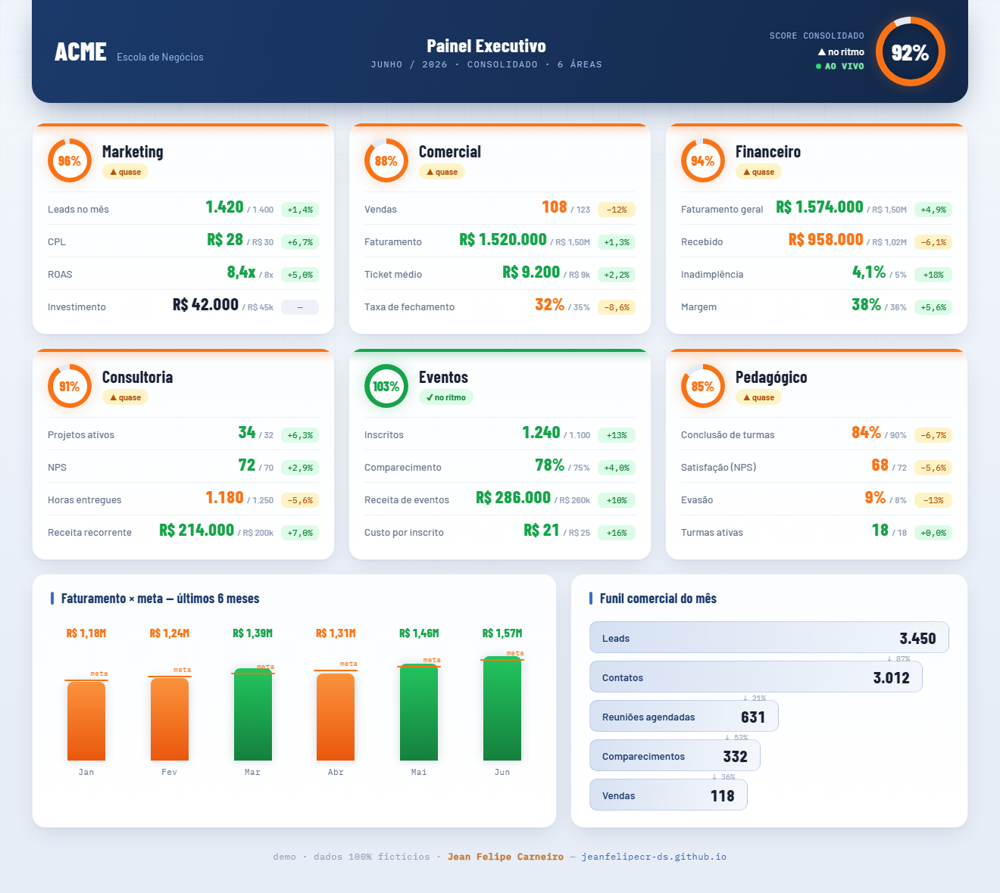

# Painel Executivo de BI

Visão executiva consolidada de uma escola de negócios: **6 áreas** (Marketing, Comercial,
Financeiro, Consultoria, Eventos, Pedagógico), cada uma com **anel de score** e KPIs contra meta,
mais gráfico de **faturamento × meta** e **funil comercial**. Arquivo **único e autocontido**.
**Dados 100% fictícios.**

🔗 **Demo ao vivo:** https://jeanfelipecr-ds.github.io/executive-bi-dashboard/

- **Anéis de score** por área + **chips de delta vs meta** (+/−%) com paleta de status.
- Gráfico **faturamento × meta** (6 meses) e **funil comercial** com conversão por etapa.
- **Sem dependências externas** (só CSS/JS puro) — abre direto no navegador.

Parte do portfólio de **Jean Felipe Carneiro** — Analista de Dados & BI · [jeanfelipecr-ds.github.io](https://jeanfelipecr-ds.github.io)

🇬🇧 <b>English</b>

 

# Executive BI Dashboard

A consolidated executive view for a business school: **6 areas** (Marketing, Sales, Finance,
Consulting, Events, Education), each with a **score ring** and KPIs vs. target, plus a
**revenue × target** chart and a **sales funnel**. A **single self-contained file**.
**100% synthetic data.**

🔗 **Live demo:** https://jeanfelipecr-ds.github.io/executive-bi-dashboard/

- **Score rings** per area + **delta-vs-target chips** (+/−%) with a status palette.
- **Revenue × target** chart (6 months) and a **sales funnel** with stage conversion.
- **No external dependencies** (pure CSS/JS) — opens straight in the browser.

Part of the portfolio of **Jean Felipe Carneiro** — Data Analyst & BI · [jeanfelipecr-ds.github.io](https://jeanfelipecr-ds.github.io)

